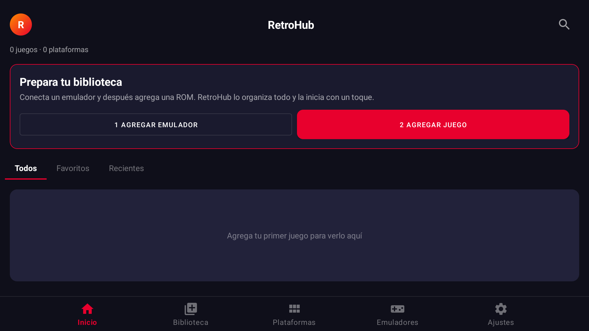
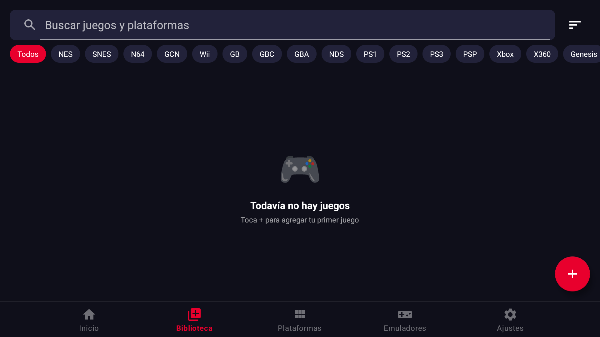
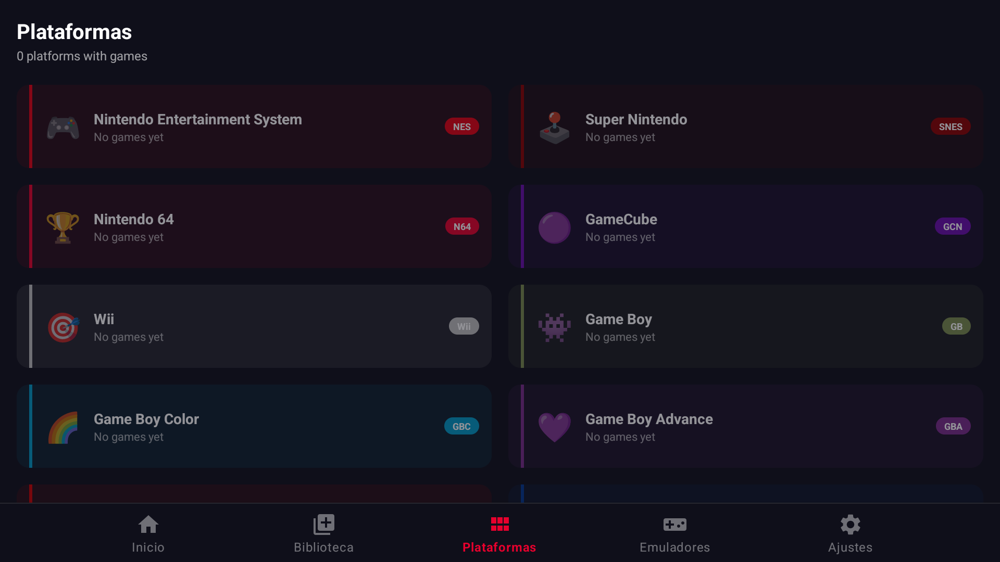
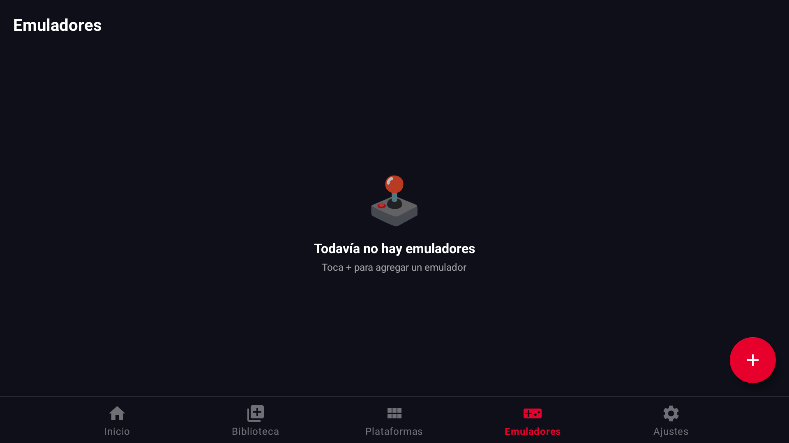
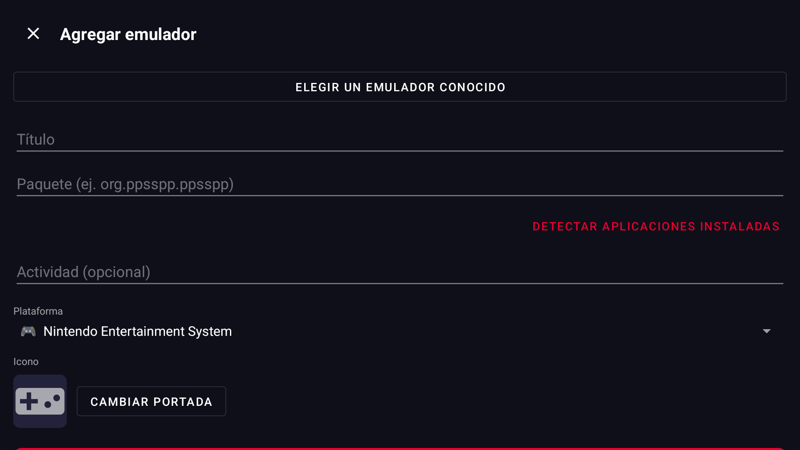
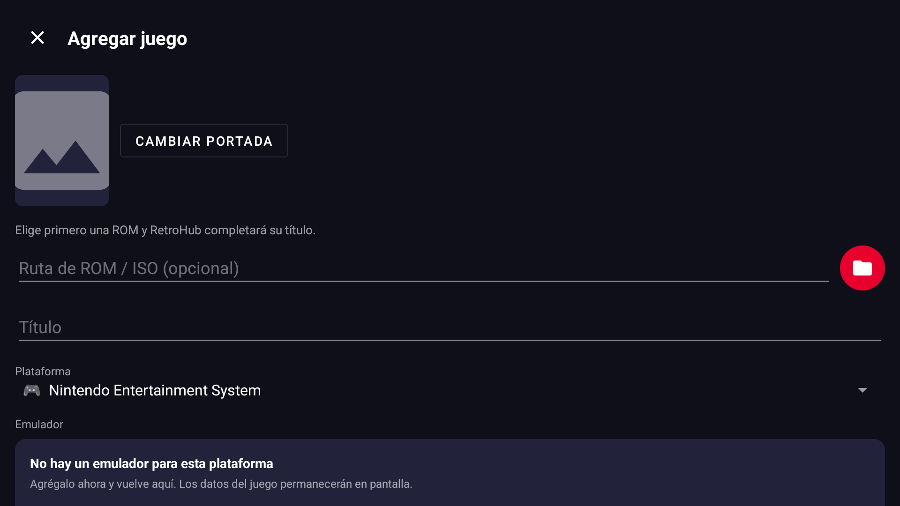
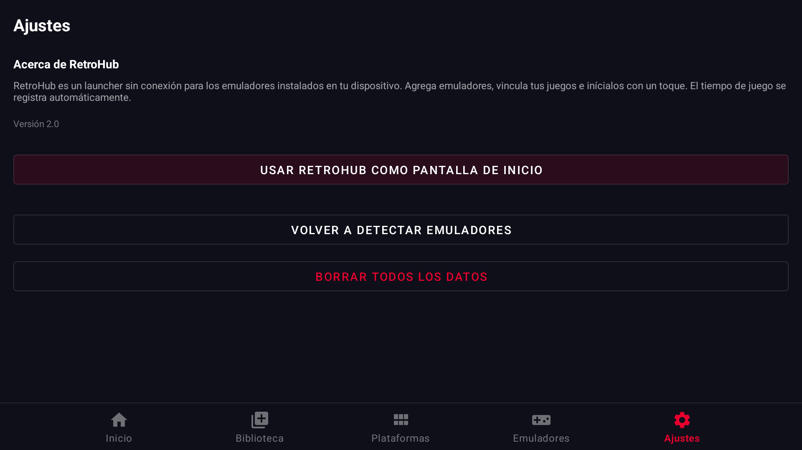

# RetroHub V2

RetroHub is a free, open-source Android launcher for retro games. Point it at your emulators and your ROM folders, and it turns them into one console-like library where every game starts with a single tap.

It works fully offline. Platforms, emulators, games, covers, favorites, play history and play time live in a local database on the device. RetroHub does not include ROMs, BIOS files, or emulators.

---

## Screenshots

Captured from RetroHub V2 running on a 1080p Android device in landscape, right after a fresh install (so the library is still empty).

| Home | Library |
|---|---|
|  |  |

| Platforms | Emulators |
|---|---|
|  |  |

| Add emulator | Add game |
|---|---|
|  |  |

| Settings (Home screen mode) |
|---|
|  |

---

## Get playing in 3 steps

1. **Add an emulator** – Home → *Add emulator*. Pick it from the list of known emulators (RetroArch, PPSSPP, Dolphin, AetherSX2, DraStic, …) or from your installed apps, and choose its platform.
2. **Import your games** – Home → *Add game*. Choose the platform and emulator, then tap **Import whole folder** and select the folder with that console's ROMs. Every game inside is added at once, with clean titles (`Super Mario World (USA) [!].sfc` → `Super Mario World`).
3. **Play** – tap the red play button on any cover.

Optional: **Settings → Use RetroHub as Home screen** makes the device boot into RetroHub and come back to it after every game, like a console.

---

## What's new in V2

**Easier setup (inspired by Beacon)**
- **Folder import:** add an entire platform folder in one step. Sub-folders are scanned (up to 3 levels), saves, images and notes are skipped, and games already in the library are never duplicated.
- **Home screen mode:** RetroHub can be selected as the device's default Home app.
- **Controller tabs:** the **L1 / R1** buttons switch between Home, Library, Platforms, Emulators and Settings.
- Guided first-run setup card on the Home screen (emulator first, game second).
- Title filled in automatically from the ROM file name.

**Reliability**
- Persisted Android `content://` document URIs, so ROMs keep opening after a reboot.
- Safer package discovery without the restricted `QUERY_ALL_PACKAGES` permission.
- No broad storage or media permission: ROMs, folders and covers use Android's system picker.
- Fixed two theme styles that broke resource linking on clean builds.

**Interface**
- One-tap play buttons in Library and Search.
- Responsive grids for phones and tablets, larger covers, 48 dp touch targets.
- Spanish localization for navigation, setup and the main game flow.

---

## RetroHub vs Beacon Game Launcher

Beacon is a popular paid Android game frontend. This is how the two compare today.

| | RetroHub V2 | Beacon |
|---|---|---|
| Price / source | **Free, open source** | Paid (~US$3), closed source |
| Accounts / internet | **None needed** | Needed for cover scraping (ScreenScraper, SteamGridDB) |
| Import a whole ROM folder | ✅ (new in V2) | ✅ |
| Use as Home launcher | ✅ (new in V2) | ✅ |
| Play-time tracking per game | ✅ | Not advertised |
| Favorites, recent, most-played sorting | ✅ | Partial |
| Custom launch arguments per game | ✅ | Per-platform launch modes |
| Play Store shortcut when emulator is missing | ✅ | — |
| Storage permission | **None** (system picker only) | Folder access |
| Automatic cover art & metadata | ❌ (manual covers) | ✅ |
| Themes, colors, fonts, backgrounds | ❌ | ✅ |
| Gallery / List / Grid views | Grid only | ✅ |
| Full controller navigation (D-pad, A/B/Y) | Partial (L1/R1 tabs) | ✅ |
| Android apps drawer | ❌ | ✅ |
| Auto re-scan of folders | ❌ (re-import manually) | ✅ |

### Roadmap to close the gap

1. Optional cover and metadata matching, kept opt-in to preserve the offline promise.
2. Full D-pad / gamepad focus navigation and a landscape TV layout.
3. Re-scan saved folders automatically to pick up new or deleted ROMs.
4. Verified launch profiles per emulator (RetroArch cores, PPSSPP, Dolphin, …).
5. List and gallery views, plus a basic theme picker.
6. Backup / export of the local catalog.

---

## Features

- Register emulators by name, package, optional activity, platform and custom icon.
- Curated list of known Android emulators, plus detection of installed apps.
- Add games one by one or a whole folder at a time.
- Per-game cover, genre, favorite flag and optional custom launch arguments.
- Launches the emulator with the ROM URI; falls back to opening the emulator alone if it does not accept the file.
- Tracks play sessions and adds elapsed time when you come back to RetroHub.
- Library filters by platform, favorites and recent; sorting by name, most played, recent or platform.
- Global search across games and platforms.

## Main screens

- **Home:** setup guide, featured recent game, recently played, recommendations and platform shortcuts.
- **Library:** searchable grid with platform chips, sorting, favorites, edit/delete and a details sheet.
- **Platforms:** built-in catalog (NES, SNES, N64, GameCube, Wii, Game Boy, DS, PS1, PS2, PS3, PSP, Xbox, Genesis, Saturn, Dreamcast, Arcade/MAME, PICO-8, GameHub, Winlator, …).
- **Emulators:** add, detect and refresh installed emulators.
- **Settings:** Home-screen mode, emulator re-check, app info and data reset.

## Technology

- **Language:** Java 17
- **Build:** Gradle 8.7, Android Gradle Plugin 8.5.0
- **SDK:** compileSdk 34, minSdk 26, targetSdk 34
- **UI:** Android Views, AppCompat, Material Components, RecyclerView
- **Architecture:** Activities/Fragments with ViewModel and LiveData
- **Database:** Room 2.6.1 (`retrohub.db`)
- **Images:** Glide 4.16.0

## Project structure

```text
app/src/main/java/com/retrohub/launcher/
  adapter/          RecyclerView adapters for games, platforms and emulators
  data/db/          Room database and DAOs
  data/model/       Room entities (Platform, Emulator, GameEntry)
  data/repository/  Repository layer
  ui/               Activities, fragments and ViewModels
  util/             Launcher, folder scanner, image storage, app detection, timers
```

## Build

Open the project in Android Studio and run the `app` module, or from a terminal:

```bash
./gradlew assembleDebug        # macOS / Linux
.\gradlew.bat assembleDebug    # Windows
```

Build notes:
- Use JDK 17 or 21 (Android Studio's bundled JDK works). JDK 25 is not supported by Gradle 8.7.
- On Windows, the project path must contain only ASCII characters (no accents) or the Android resource tool fails. Move the project, or map a drive with `subst R: "C:\path\to\RETROHUB"` and build from `R:\`.

## Notes

- RetroHub does not include emulators, ROMs or BIOS files. Use your own legally obtained files.
- Launch behavior depends on whether each emulator accepts ROM files through Android intents.
